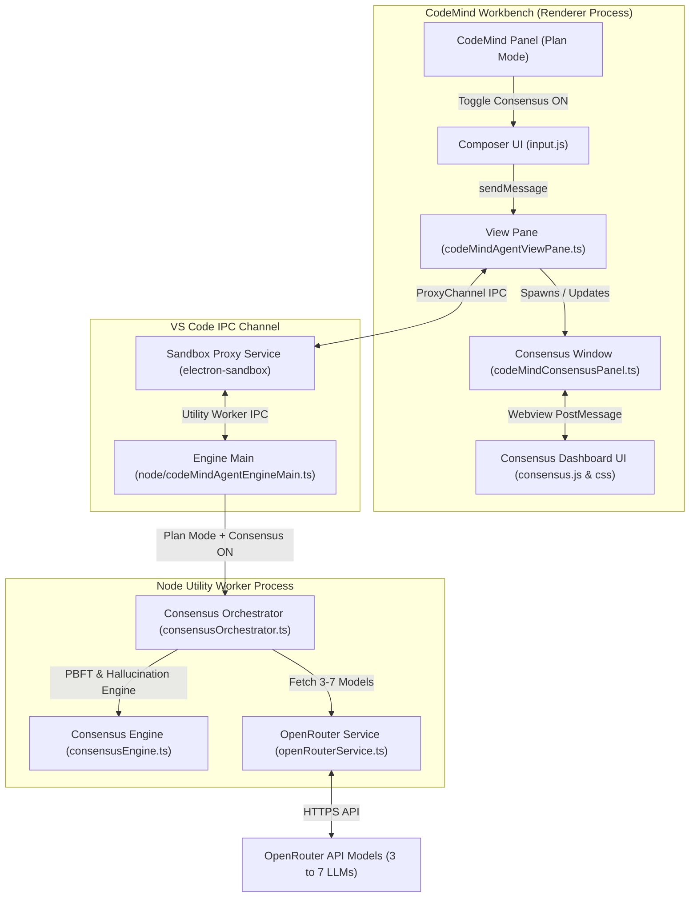

# Technical Implementation Plan: Integrating LLM Consensus into CodeMind Plan Mode

## Executive Overview

This technical plan outlines the integration of the **LLM Consensus Framework** (from [`LLM_consensus/LLM-Consensus`](file:///e:/CodeMind/LLM_consensus/LLM-Consensus)) into **CodeMind** (VS Code workbench contribution).

When a user switches CodeMind to **Plan Mode**, an optional **Multi-Agent Consensus Mode** toggle can be activated. When enabled:
1. The user can select **3 to 7 LLM models** (powered by OpenRouter API).
2. The user's planning prompt is dispatched to all selected models concurrently.
3. A **dedicated, separate Webview Window/Tab** automatically spawns (or can be opened via a button) to display real-time deliberation, critiques, hallucination scoring, and consensus progress.
4. Models critique each other and run PBFT (Practical Byzantine Fault Tolerance) rounds until agreement is reached.
5. The final, synthesized consensus plan is returned to CodeMind's main panel for execution.

---

## Architectural Mapping

We will reuse the proven core algorithms from `LLM_consensus` with zero unnecessary rewrites, adapting the transport from WebSockets/HTTP to VS Code's internal IPC and Webview architecture.



### Component Code Mapping Table

| `LLM_consensus` Component | Purpose | Target Location in CodeMind |
|---|---|---|
| `backend/src/services/openRouterService.ts` | Multi-model queries & critiques | [`node/consensus/openRouterService.ts`](file:///e:/CodeMind/vscodium/src/stable/src/vs/workbench/contrib/codemindAgent/node/consensus/openRouterService.ts) |
| `backend/src/services/consensusEngine.ts` | PBFT phases, cosine similarity, hallucination scoring, tiebreaker debate | [`node/consensus/consensusEngine.ts`](file:///e:/CodeMind/vscodium/src/stable/src/vs/workbench/contrib/codemindAgent/node/consensus/consensusEngine.ts) |
| `backend/src/orchestrator/masterOrchestrator.ts` | Multi-round orchestration loop & event dispatch | [`node/consensus/consensusOrchestrator.ts`](file:///e:/CodeMind/vscodium/src/stable/src/vs/workbench/contrib/codemindAgent/node/consensus/consensusOrchestrator.ts) |
| `backend/src/config/models.ts` | Model configurations (3-7 models) & OpenRouter API setup | Registered in CodeMind settings & configuration registry ([`codemindAgent.contribution.ts`](file:///e:/CodeMind/vscodium/src/stable/src/vs/workbench/contrib/codemindAgent/browser/codemindAgent.contribution.ts)) |
| `frontend/src/components/*` | React / Next.js Dashboard UI components | Native, zero-dependency VS Code Webview bundle ([`browser/media/consensus.js`](file:///e:/CodeMind/vscodium/src/stable/src/vs/workbench/contrib/codemindAgent/browser/media/consensus.js) + [`consensus.css`](file:///e:/CodeMind/vscodium/src/stable/src/vs/workbench/contrib/codemindAgent/browser/media/consensus.css)) |

---

## User Interface & Experience Design

### 1. Plan Mode Integration & Control Button
* In CodeMind's chat composer, when **Plan Mode** is selected, a new pill/button **`⚡ Multi-Agent Consensus`** appears in the toolbar.
* Clicking this button toggles Multi-Agent mode **ON / OFF**.
* When enabled, a model selection popover / settings button allows picking between **3 to 7 models** (e.g., Trinity Large, Nemotron, GPT-OSS 120B, Liquid LFM, etc.).

```
+-------------------------------------------------------------------------+
| [ Mode: Plan Mode v ]  [ ⚡ Multi-Agent Consensus: ON (5 Models) ]  [⚙] |
+-------------------------------------------------------------------------+
| Prompt: "Design a high-throughput caching strategy for our DB..."       |
+-------------------------------------------------------------------------+
```

### 2. Auto-Spawned / Manual Deliberation Window
* When a query is submitted with Consensus Mode ON, CodeMind automatically opens a dedicated **"CodeMind Consensus Deliberation" Webview Editor Tab/Panel** (or user can open it manually via a button in the main panel).
* The window uses native VS Code theme tokens (`var(--vscode-*)`) to look premium in Dark, Light, and High-Contrast modes.

#### Deliberation Window Layout Structure:
1. **Header & Phase Indicator**: Shows current PBFT phase (`Pre-Prepare` ➔ `Prepare (Critique)` ➔ `Commit` ➔ `Finalized` / `Debate Tiebreaker`) with a live progress bar and consensus percentage score.
2. **Validator Network Graph**: Visualizes agreement connections and critique channels between the selected 3–7 models.
3. **Model Proposal Cards Grid**: Shows individual responses, reasoning steps, confidence ratings, and hallucination warning badges.
4. **Critique & Debate Feed**: Real-time expandable cards displaying how models evaluate and challenge each other's proposals.

```
+-----------------------------------------------------------------------------------+
|  ⚡ CodeMind Multi-Agent Consensus Deliberation                                   |
|  Phase: [ Prepare / Critiquing ]   Consensus Score: 58% [████████░░░░]          |
+-----------------------------------------------------------------------------------+
|  [ Validator Network Graph ]        |  [ Model Proposal Cards (5 Selected) ]      |
|  (O) Model A <---> (O) Model B     |  +----------------------------------------+  |
|   \                 /              |  | Model A (Trinity 120B)  | Conf: 92%    |  |
|    \-> (O) Model C <-              |  | "Use redis cluster with LRU eviction..."|  |
|                                    |  +----------------------------------------+  |
+------------------------------------+----------------------------------------------+
|  [ Live Critique & Debate Feed ]                                                  |
|  • [Model B -> Model A]: "Critique: Redis memory overhead exceeds limit..."       |
|  • [Model A -> Model B]: "Defense: We can mitigate by setting key eviction..."     |
+-----------------------------------------------------------------------------------+
```

---

## Detailed Code Modifications

---

### Component 1: Engine Common Protocol & Storage
#### [MODIFY] [`common/codeMindAgentEngineService.ts`](file:///e:/CodeMind/vscodium/src/stable/src/vs/workbench/contrib/codemindAgent/common/codeMindAgentEngineService.ts)
- Add IPC consensus types:
  ```typescript
  export interface ICodeMindConsensusModelConfig {
    id: string;
    displayName: string;
    openRouterId: string;
    specialty: string;
  }
  
  export interface ICodeMindConsensusSettings {
    enabled: boolean;
    models: string[]; // List of 3 to 7 selected model IDs
    openRouterApiKey?: string;
  }
  ```
- Extend `ICodeMindEngineEvent` to include consensus events (`consensus_phase_change`, `consensus_model_response`, `consensus_critique`, `consensus_hallucination`, `consensus_finalized`).

#### [MODIFY] [`electron-sandbox/codeMindAgentEngineService.ts`](file:///e:/CodeMind/vscodium/src/stable/src/vs/workbench/contrib/codemindAgent/electron-sandbox/codeMindAgentEngineService.ts)
- Store `codemind.openRouterApiKey` in VS Code's secret storage service (`ISecretStorageService`).
- Forward consensus events over the IPC channel proxy.

---

### Component 2: Workbench Contribution & Configuration
#### [MODIFY] [`browser/codemindAgent.contribution.ts`](file:///e:/CodeMind/vscodium/src/stable/src/vs/workbench/contrib/codemindAgent/browser/codemindAgent.contribution.ts)
- Register configuration properties:
  - `codemind.consensus.enabled`: boolean (default `false`)
  - `codemind.consensus.selectedModels`: array of strings (default: 5 default OpenRouter models)
  - `codemind.consensus.autoOpenWindow`: boolean (default `true`)
- Register command `workbench.action.openCodeMindConsensusWindow` to open/bring the Consensus Deliberation Webview window to focus.

---

### Component 3: Panel UI & Webview Window Host
#### [MODIFY] [`browser/codeMindAgentViewPane.ts`](file:///e:/CodeMind/vscodium/src/stable/src/vs/workbench/contrib/codemindAgent/browser/codeMindAgentViewPane.ts)
- Add toggle control handler for Multi-Agent Consensus in the composer toolbar.
- Implement `openConsensusWebviewPanel()` to instantiate a VS Code Webview Editor panel or side panel hosting the deliberation window.

#### [NEW] [`browser/codeMindConsensusPanel.ts`](file:///e:/CodeMind/vscodium/src/stable/src/vs/workbench/contrib/codemindAgent/browser/codeMindConsensusPanel.ts)
- Manages the lifecycle of the standalone Consensus Webview Panel (`WebviewPanel`).
- Listens to consensus events from `codeMindAgentEngineService` and posts them to the Webview.

#### [NEW] [`browser/media/consensus.js`](file:///e:/CodeMind/vscodium/src/stable/src/vs/workbench/contrib/codemindAgent/browser/media/consensus.js)
- Standalone Vanilla JS client for the Webview.
- Renders:
  - Phase progress indicator
  - Validator agreement network graph (SVG)
  - Model response cards grid
  - Live critique and debate timeline

#### [NEW] [`browser/media/consensus.css`](file:///e:/CodeMind/vscodium/src/stable/src/vs/workbench/contrib/codemindAgent/browser/media/consensus.css)
- CSS styles using editor theme variables (`var(--vscode-*)`) for seamless light/dark mode support.

---

### Component 4: Modular Consensus Engine Core
#### [NEW] [`node/consensus/openRouterService.ts`](file:///e:/CodeMind/vscodium/src/stable/src/vs/workbench/contrib/codemindAgent/node/consensus/openRouterService.ts)
- Ported directly from [`LLM_consensus/LLM-Consensus/backend/src/services/openRouterService.ts`](file:///e:/CodeMind/LLM_consensus/LLM-Consensus/backend/src/services/openRouterService.ts).
- Queries OpenRouter API for 3 to 7 selected models, supporting parallel fan-out and structured critique generation.

#### [NEW] [`node/consensus/consensusEngine.ts`](file:///e:/CodeMind/vscodium/src/stable/src/vs/workbench/contrib/codemindAgent/node/consensus/consensusEngine.ts)
- Ported directly from [`LLM_consensus/LLM-Consensus/backend/src/services/consensusEngine.ts`](file:///e:/CodeMind/LLM_consensus/LLM-Consensus/backend/src/services/consensusEngine.ts).
- Implements:
  - Cosine similarity algorithm for text divergence
  - Hallucination detection engine
  - PBFT phase consensus validation
  - AutoGen-style debate tiebreaker (for close forced consensus)

#### [NEW] [`node/consensus/consensusOrchestrator.ts`](file:///e:/CodeMind/vscodium/src/stable/src/vs/workbench/contrib/codemindAgent/node/consensus/consensusOrchestrator.ts)
- Ported from [`LLM_consensus/LLM-Consensus/backend/src/orchestrator/masterOrchestrator.ts`](file:///e:/CodeMind/LLM_consensus/LLM-Consensus/backend/src/orchestrator/masterOrchestrator.ts).
- Drives the consensus pipeline step-by-step and streams IPC progress events to the renderer.

#### [MODIFY] [`node/codeMindAgentEngineMain.ts`](file:///e:/CodeMind/vscodium/src/stable/src/vs/workbench/contrib/codemindAgent/node/codeMindAgentEngineMain.ts)
- In `queryStream`, check if `request.planMode` is active AND `consensusSettings.enabled` is true.
- If enabled, delegate turn execution to `consensusOrchestrator.ts` using the OpenRouter API key.
- Once consensus finalization finishes, return the final synthesized answer as the agent's plan response.

---

## Verification & Validation Plan

### 1. Manual Verification Steps
- **Toggle Test**: Switch CodeMind to Plan Mode. Verify the `⚡ Multi-Agent Consensus` button appears and can be toggled ON/OFF.
- **Model Selection Test**: Select 3, 5, and 7 models from the OpenRouter model settings menu. Ensure setting constraints (min 3, max 7) are strictly enforced.
- **Window Spawn Test**: Submit a prompt in Plan Mode with Consensus ON. Verify that the **CodeMind Consensus Deliberation Window** opens automatically in a separate Webview tab.
- **Deliberation Real-Time Updates Test**: Observe the Webview as models output initial proposals, perform peer critiques, show hallucination badges, and update the PBFT progress bar.
- **Plan Synthesis Test**: Ensure the finalized consensus result is returned back to the primary CodeMind chat window as a clear, formatted execution plan.
- **Theme Test**: Toggle VS Code between Dark, Light, and High Contrast themes. Verify that all components in the Consensus Webview render legibly using standard `--vscode-*` CSS variables.
